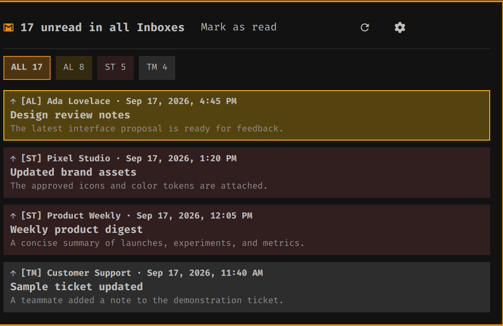

# Mailbox

Mailbox is an Omarchy Quickshell bar plugin that shows Gmail and HEY unread counts, account badges, message previews, and locally cached conversation text from the email sessions already open in your browser. It does not use OAuth, request an email password, or keep a separate email session.

## Preview



The preview uses fictional `.test` accounts and sample messages; it contains no real mailbox data.

## Features

- Automatic Gmail multi-account discovery and HEY account discovery from verified open pages.
- Rotating unread badge in the Omarchy bar and a combined inbox popup.
- Direct links that open the selected Gmail or HEY conversation rather than the generic Inbox.
- Local desktop-notification ingestion while Gmail and HEY tabs are closed.
- Per-account notification health in Preferences; a warning opens the provider account so blocked browser notifications can be enabled.
- Optional plain-text body cache for conversations the user has already opened; enabled by default and bounded to the configured per-account message limit.
- Semantic account colors that update immediately with the active Omarchy theme.
- Local “Mark as read” tranquility state that never modifies email remotely.
- Configurable `SUPER+SHIFT+<letter>` shortcut and full keyboard navigation.
- Localized interface for 19 languages.

## Requirements

- Omarchy Quattro with the plugin-enabled Quickshell shell.
- Node.js and `xdg-settings` from the standard Omarchy environment.
- Chromium, Brave, or Google Chrome with an existing Gmail or HEY session.

Everything runs as the desktop user. Mailbox never asks for administrator access, never changes system browser policies, and never downloads anything during setup. The browser bridge is a bundled extension plus a per-user Native Messaging host, registered the same way Omarchy registers its own Chromium extensions: a `NativeMessagingHosts` manifest in the browser's user configuration and, for Chromium and Brave, a `--load-extension` entry in the user's own `~/.config/chromium-flags.conf` or `~/.config/brave-flags.conf`.

## Installation

```bash
omarchy plugin add https://github.com/avillagran/omarchy-mailbox --enable
```

Open Mailbox preferences from the bar and pick your browser:

- **Install in Chromium** or **Install in Brave** registers the per-user host, adds the bundled extension to that browser's user flags file, and finishes after you quit and reopen the browser. No Developer mode is needed.
- **Set up Chrome** registers the per-user host and opens a small Mailbox window beside Chrome for the one manual step Google Chrome requires. Chrome ignores `--load-extension` and has no per-user external registration on Linux, so the extension is added from Chrome's own Extensions page. The window has a button that opens Chrome (with `chrome://extensions` on the clipboard to paste), asks you to turn on **Developer mode**, and offers a **Mailbox Local Bridge** tile to drag onto the page (or a button that shows the `bridge-extension/source` folder for **Load unpacked**). Each step is ticked off from Chrome's own profile state. It runs as your user and never asks for a password.

Then open each Gmail account and the HEY Imbox normally. Mailbox discovers those pages without asking for email credentials or copying browser cookies.

After a plugin update, quit and reopen Chromium or Brave; in Chrome click **Reload** on the Mailbox Local Bridge card in the Extensions page. Refresh the mail pages afterwards. If the browser profile changes, check that profile too. Do not move or delete the installed plugin directory while the extension is loaded. If Mailbox warns about a legacy system registration from an earlier release, ask an administrator to remove that root-owned file first; a system-enforced registration overrides the user's copy and Mailbox never modifies system directories.

## Usage

- Click the bar widget to open or close the inbox popup.
- Press `TAB` to rotate account tabs.
- Press `LEFT` or `RIGHT` to change account.
- Press `UP` or `DOWN` to select a message; the list follows the selection.
- Press `SPACE` to open the selected cached message; it stays open while you move with `UP` and `DOWN`, so you read message after message. Press `SPACE` again to close it.
- Press `SHIFT+SPACE` to open every message in the list; press it again to close them all.
- Press `R` to reply to the selected message. Mailbox saves what you type as a local draft while you write. **Reply in Gmail** (or `CTRL+ENTER`) opens that conversation in the matching account with the reply box already filled; you review it and press **Send** there. Mailbox never sends mail. For HEY, and whenever the reply box cannot be filled, the text is on the clipboard to paste. `ESC` closes the box and keeps the draft.
- Press `ENTER` to open the selected conversation in its email provider.
- Press `,` to open preferences and `LEFT` to return to the inbox.
- The optional default shortcut is `SUPER+SHIFT+Q`; its letter is configurable in preferences.

## Local data and privacy

Mailbox reads only `https://mail.google.com/*` and `https://app.hey.com/*` pages through its local extension. The extension sends snapshots to `io.github.avillagran.mailbox`, a Native Messaging host on the same machine. Mailbox does not transmit mail data to an external service. Links opened from the panel are limited to `https://mail.google.com/` and `https://app.hey.com/` addresses, and all email text is rendered as plain text.

Preferences are stored in `~/.config/omarchy/mailbox.json`. Reply drafts are stored as plain text in `~/.local/state/omarchy/mailbox/drafts/` (user-only permissions) until you discard them. Bounded message previews and optional plain-text conversation bodies are stored in `~/.cache/omarchy/mailbox/` with user-only permissions. Full bodies are captured only after the user opens the conversation in Gmail or HEY; Mailbox never opens hidden conversations to collect them because that could change remote read state. Disable **Download email content** to purge cached bodies.

The extension permissions are limited to Native Messaging, tabs, scripting, alarms, `https://mail.google.com/*`, and `https://app.hey.com/*`. The plugin and extension execute as unsandboxed local code, like other Omarchy plugins, so review the source and declared capabilities before installation.

## External dependencies and browser setup

Mailbox depends only on the local browser and the Omarchy tools listed under Requirements. Setup writes user-owned files inside `$HOME`: the Native Messaging manifests, the selected browser's flags file, and a removal marker under `~/.config/omarchy/`. Every write refuses symlinks and foreign ownership and replaces files atomically. Nothing runs as root and nothing is downloaded.

The optional keyboard shortcut is created only when you save it in Preferences. It writes `~/.config/hypr/mailbox.lua` and adds a single `require("hypr.mailbox")` line to `~/.config/hypr/hyprland.lua`, leaving every other line untouched; the removal command below deletes both.

Every file Mailbox reads is size-capped before parsing, and the Native Messaging host refuses oversized messages and keeps at most 16 accounts, 200 messages per account and 40 MiB of cached bodies in total.

## Removal

Use the remove button in Mailbox preferences first. It deletes the per-user Native Messaging manifests and Mailbox's entries from the user flags files; then quit and reopen Chromium or Brave, or remove **Mailbox Local Bridge** from Chrome's Extensions page. Remove the generated shortcut **before** removing the plugin:

```bash
PLUGIN="$HOME/.config/omarchy/plugins/io.github.avillagran.omarchy-mailbox"
node "$PLUGIN/bin/mailbox-bridge-register.js" --remove
node "$PLUGIN/bin/mailbox-keybind.js" --uninstall
omarchy plugin remove io.github.avillagran.omarchy-mailbox
```

User preferences and cache are deliberately retained. Delete them only when you no longer want the saved configuration or previews:

```bash
rm -f ~/.config/omarchy/mailbox.json
rm -rf ~/.cache/omarchy/mailbox
rm -rf ~/.local/state/omarchy/mailbox
```

## License

MIT — see [LICENSE](LICENSE).
